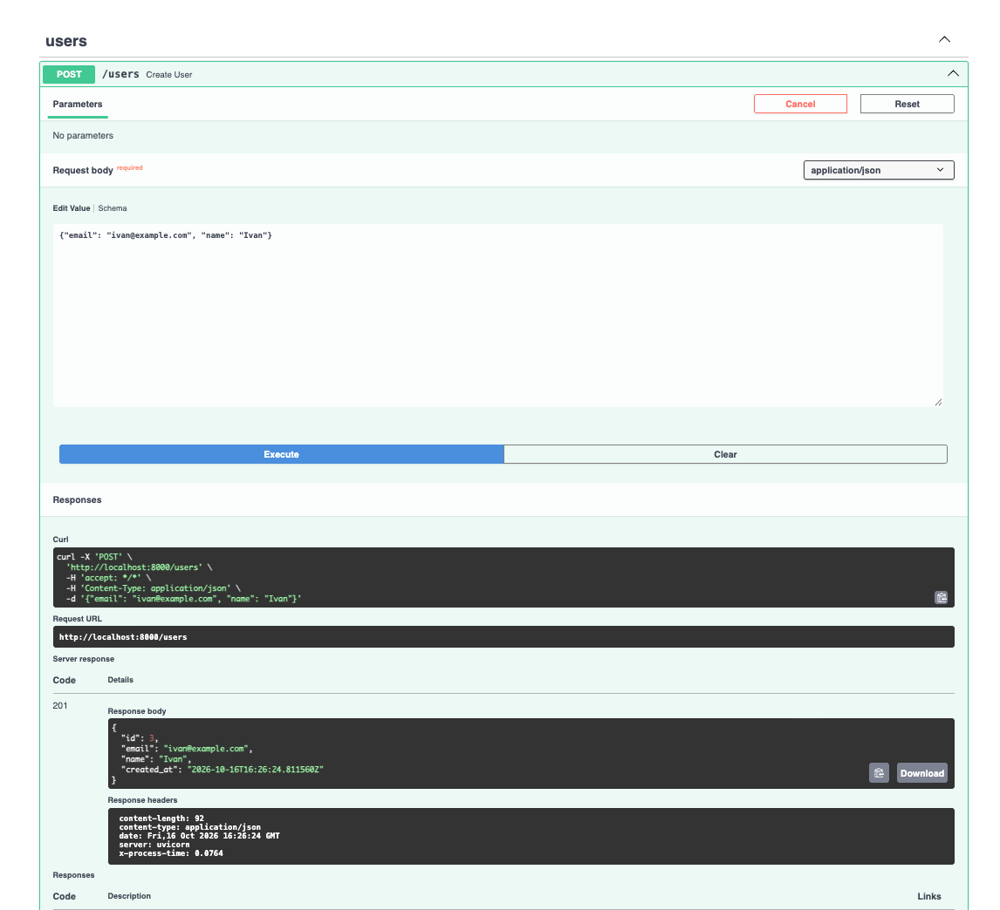
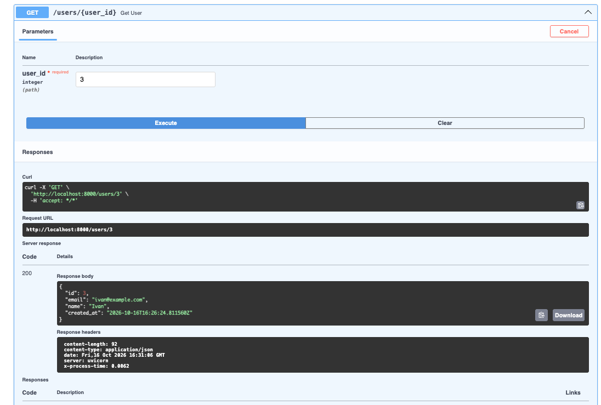
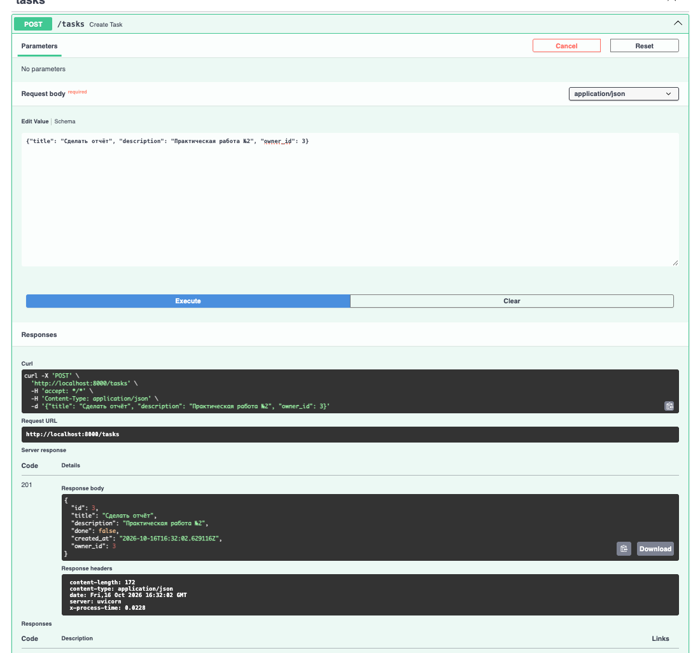
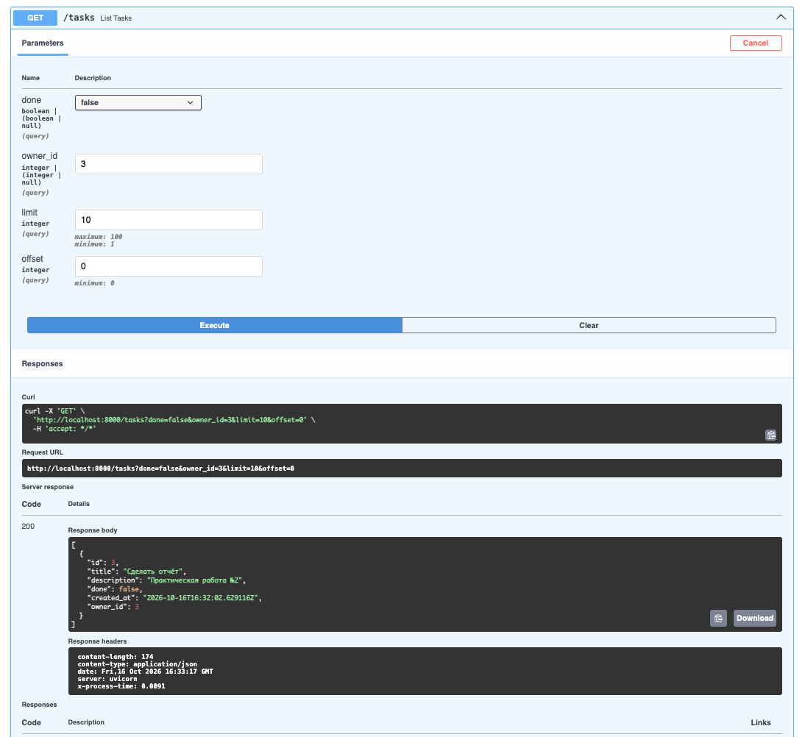
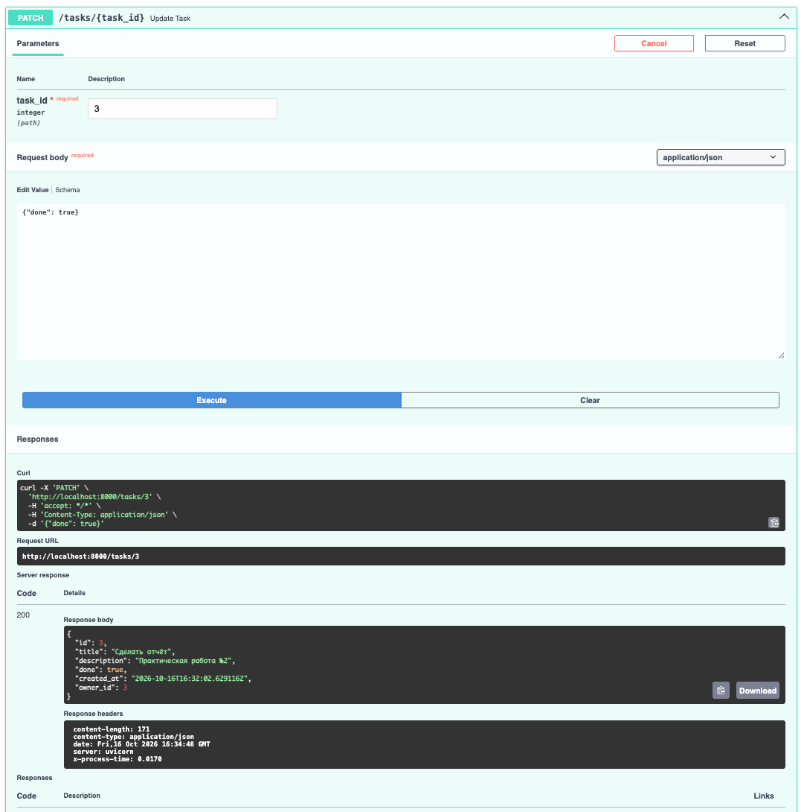
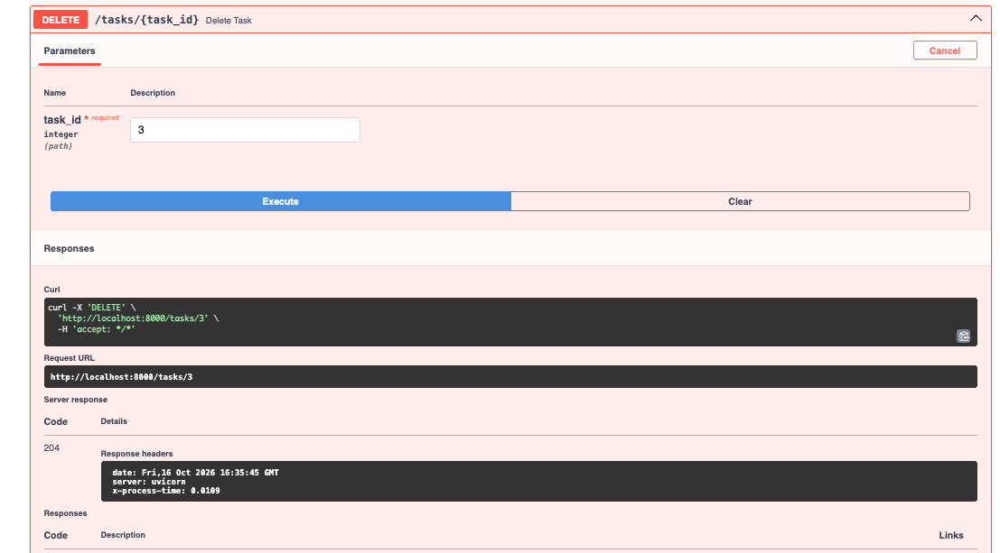
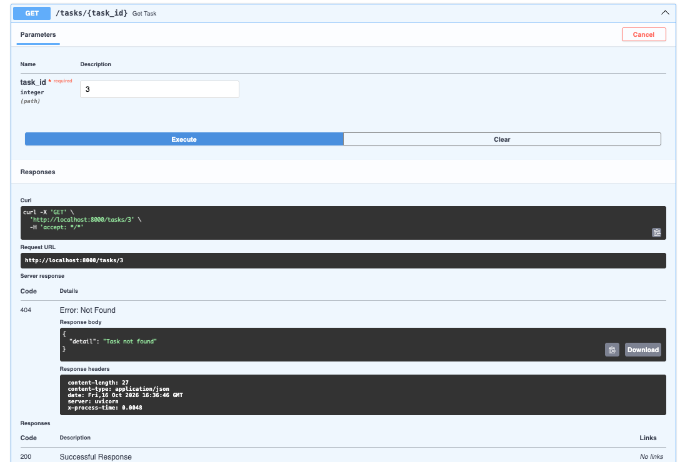
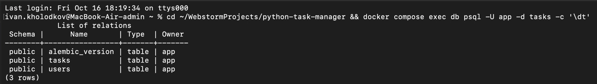
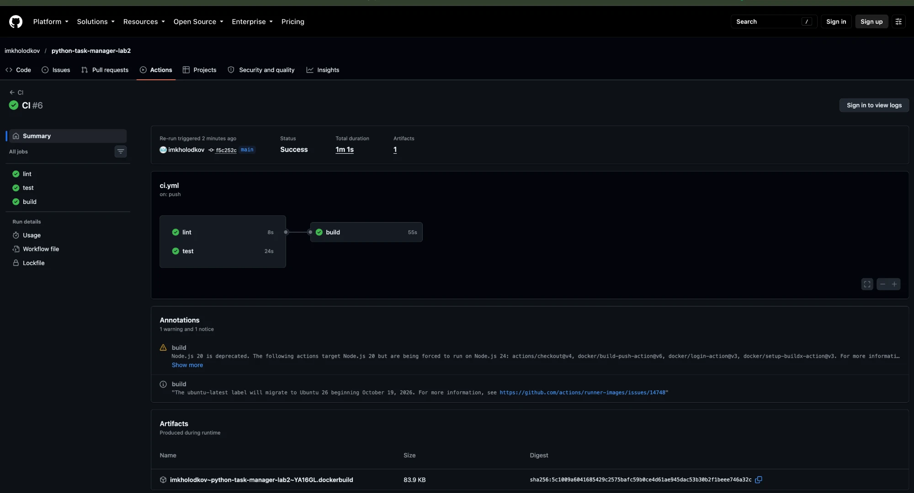
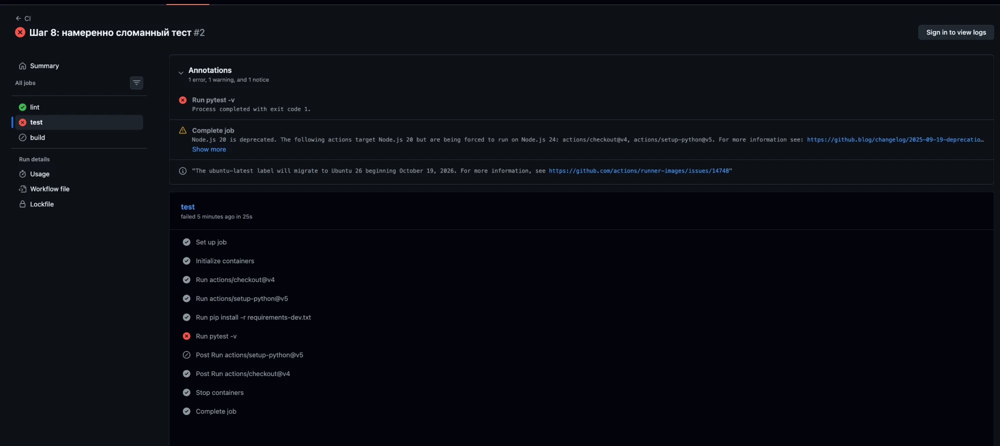

# Менеджер задач — FastAPI + PostgreSQL + SQLAlchemy + Pydantic

[](https://github.com/imkholodkov/python-task-manager-lab2/actions/workflows/ci.yml)

Практическая работа № 2: REST API для хранения пользователей и их задач.

Стек: FastAPI, Starlette (middleware), SQLAlchemy 2.0 (async, asyncpg), Pydantic v2, pydantic-settings, Alembic, PostgreSQL 16 в Docker.

## Требования

- Python 3.11+
- Docker и Docker Compose
- Git

## Запуск

1. Клонировать репозиторий и перейти в папку проекта:

   ```bash
   git clone https://github.com/imkholodkov/python-task-manager-lab2.git
   cd python-task-manager-lab2
   ```

2. Создать файл с переменными окружения из образца:

   ```bash
   cp .env.example .env
   ```

3. Запустить PostgreSQL и проверить доступность:

   ```bash
   docker compose up -d db
   docker compose exec db psql -U app -d tasks -c "select 1"
   ```

4. Создать виртуальное окружение и установить зависимости:

   ```bash
   python3 -m venv .venv
   source .venv/bin/activate
   pip install -r requirements.txt
   ```

5. Применить миграции (таблицы создаются только миграцией Alembic, `create_all` не используется):

   ```bash
   alembic upgrade head
   ```

6. Запустить сервис:

   ```bash
   uvicorn app.main:app --reload
   ```

7. Открыть Swagger UI: http://localhost:8000/docs

Остановка: `Ctrl+C` для сервиса, `docker compose stop` для базы. Данные сохраняются в томе `pgdata`.

## Структура проекта

```
app/
├── __init__.py
├── main.py          # создание приложения, middleware, подключение роутеров
├── config.py        # настройки (pydantic-settings), DATABASE_URL
├── db.py            # асинхронный движок, фабрика сессий, Base, get_session
├── models.py        # ORM-модели User и Task (SQLAlchemy 2.0)
├── schemas.py       # Pydantic-схемы Create / Read / Update
└── routers/
    ├── users.py     # /users
    └── tasks.py     # /tasks
migrations/          # Alembic (async), первая миграция в versions/
alembic.ini
docker-compose.yml   # PostgreSQL 16
requirements.txt
.env.example         # образец DATABASE_URL
```

## Эндпоинты

| Метод | Путь | Описание | Коды ответа |
|---|---|---|---|
| POST | /users | создать пользователя | 201, 409 (email занят), 422 |
| GET | /users/{id} | получить пользователя | 200, 404 |
| POST | /tasks | создать задачу | 201, 404 (нет владельца), 422 |
| GET | /tasks | список задач; фильтры `done`, `owner_id`; пагинация `limit` (1–100), `offset` | 200 |
| GET | /tasks/{id} | получить задачу | 200, 404 |
| PATCH | /tasks/{id} | частично обновить задачу | 200, 404, 422 |
| DELETE | /tasks/{id} | удалить задачу | 204, 404 |

Каждый ответ содержит заголовок `X-Process-Time` — время обработки запроса в секундах; метод, путь, статус и время пишутся в лог сервиса.

## Скриншоты

### Swagger UI

| Запрос | Скриншот |
|---|---|
| POST /users → 201 |  |
| GET /users/{id} → 200 |  |
| POST /tasks → 201 |  |
| GET /tasks → 200 |  |
| PATCH /tasks/{id} → 200 |  |
| DELETE /tasks/{id} → 204 |  |
| GET /tasks/{id} → 404 |  |

### Таблицы в БД (`\dt` в psql)

```bash
docker compose exec db psql -U app -d tasks -c '\dt'
```



## Ответы на контрольные вопросы

**1. Чем FastAPI отличается от Starlette и какие компоненты Starlette он использует?**

Starlette — это сам веб-фреймворк: он принимает запросы, отдаёт ответы, умеет маршрутизацию и middleware. FastAPI сделан поверх него — класс `FastAPI` прямо наследуется от `Starlette`. Сверху FastAPI добавляет то, ради чего его обычно и берут: проверку входных данных через Pydantic по аннотациям типов, зависимости через `Depends` и автоматическую документацию (тот самый Swagger на `/docs`). Всё остальное FastAPI берёт у Starlette: `Request` и `Response`, роутинг, middleware, обработку исключений, фоновые задачи, WebSocket и тестовый клиент. Middleware с `X-Process-Time` в моём проекте — как раз Starlette.

**2. Зачем разделять схемы Create, Read и Update?**

Потому что при создании, чтении и обновлении нужны разные поля. Когда создаю задачу, я не передаю `id` и `created_at` — их ставит сервер. Когда получаю задачу, эти поля, наоборот, должны быть в ответе. А при обновлении хочется поменять одно поле и не присылать остальные, поэтому в Update всё необязательное. Если сделать одну схему на всё, она либо будет требовать лишнее, либо разрешит то, чего нельзя, — например, клиент сможет сам задать себе `id`.

**3. Что делает `from_attributes=True`?**

Позволяет Pydantic собрать схему не только из словаря, но и из обычного объекта — брать значения из его атрибутов. Мне это нужно, чтобы в эндпоинте можно было просто вернуть объект SQLAlchemy из базы, а FastAPI сам превратил его в `TaskRead` или `UserRead`. В старом Pydantic v1 то же самое называлось `orm_mode = True`.

**4. Почему сессия передаётся через Depends, а не создаётся глобально?**

Сессия SQLAlchemy хранит своё состояние — открытую транзакцию и загруженные объекты, — и делить её между параллельными запросами нельзя: данные разных запросов начнут перемешиваться. Через `Depends(get_session)` у каждого запроса своя сессия, и после ответа она точно закрывается — это делает код после `yield`. Плюс в тестах такую зависимость легко подменить на тестовую базу.

**5. Чем `exclude_unset=True` отличается от `exclude_none=True`?**

`exclude_unset` убирает поля, которые клиент вообще не прислал. `exclude_none` убирает все поля, где `None`, — даже если клиент сам явно прислал `null`. Для PATCH я использую `exclude_unset`: тогда непереданные поля остаются как были, а `{"description": null}` реально очищает описание. С `exclude_none` такой `null` просто выкинулся бы, и очистить поле было бы нельзя.

**6. Почему в production таблицы не создают через `create_all`?**

`create_all` умеет только создать таблицы, которых ещё нет. Если таблица уже есть, а я добавил колонку или поменял тип, он ничего не сделает. И непонятно, в каком состоянии сейчас схема базы и как вернуть её назад. С Alembic каждое изменение лежит отдельным файлом-миграцией в репозитории: его видно на ревью, на любом сервере оно применяется одной командой `alembic upgrade head`, а если что-то пошло не так, можно откатиться через `alembic downgrade` без потери данных.

## Сделано сверх задания

В коде каждое дополнение помечено комментарием «Сверх задания».

| Где | Что |
|---|---|
| requirements.txt | `sqlalchemy[asyncio]` (ставит greenlet для async-режима), `email-validator` (нужен для `EmailStr`) |
| config.py | чтение `DATABASE_URL` из файла `.env` в дополнение к переменной окружения |
| db.py | `expire_on_commit=False` |
| models.py | длины `email` 320 и `name` 100, индекс на `tasks.owner_id` |
| schemas.py | запрет явного `null` для NOT NULL полей в Update-схемах (422 вместо 500), длина `name` 1–100 |
| routers/users.py | проверка email до вставки + перехват `IntegrityError` при гонке |
| routers/tasks.py | сортировка по `id` для стабильной пагинации, `limit` по умолчанию 20, `offset ≥ 0` |
| routers/*.py | коды 404 и 409 описаны в Swagger UI через `responses` |
| main.py | настройка `logging.basicConfig` |
| .gitignore | исключение `.venv`, `.env`, кэша и настроек IDE |

---

# Практическая работа № 3 — тесты, Docker, CI/CD

## Тесты локально

Тесты работают с реальной PostgreSQL, отдельной БД `tasks_test` (создаётся скриптом `docker/init-test-db.sql` при первом запуске тома). Таблицы создаются один раз за сессию, перед каждым тестом очищаются `TRUNCATE ... RESTART IDENTITY`; `get_session` подменяется через `app.dependency_overrides` (см. `tests/conftest.py`).

```bash
docker compose up -d db
pip install -r requirements-dev.txt
ruff check . && ruff format --check .
pytest -v
```

Если том `pgdata` создан ещё в ПР № 2 и `tasks_test` в нём нет: `docker compose exec db createdb -U app tasks_test`. Другая БД задаётся переменной `TEST_DATABASE_URL`.

## Запуск через Docker Compose

```bash
docker compose up -d --build
```

Порядок старта: `db` проходит healthcheck (`pg_isready`) → `migrate` выполняет `alembic upgrade head` и завершается с кодом 0 → стартует `app` на http://localhost:8000/docs.

Тесты через Docker Compose (БД и pytest — оба в контейнерах):

```bash
docker compose --profile test run --rm tests
```

## CI/CD

`.github/workflows/ci.yml`:

- `lint` — `ruff check` и `ruff format --check`, на каждый push и pull request;
- `test` — pytest против сервиса `postgres:16`, на каждый push и pull request;
- `build` — `needs: [lint, test]`, только при push в `main`: сборка образа и публикация в GHCR и Docker Hub (секреты `DOCKERHUB_USERNAME`, `DOCKERHUB_TOKEN`).

Образ в GHCR: https://github.com/imkholodkov/python-task-manager-lab2/pkgs/container/python-task-manager

Образ в Docker Hub: https://hub.docker.com/r/imkholodkov/python-task-manager

### Скриншоты

Успешный pipeline:



«Упавший» pipeline (PR с намеренно сломанным тестом):



## Ответы на контрольные вопросы ПР № 3

**1. Чем CI отличается от CD (continuous delivery и continuous deployment)?**
CI — каждое изменение автоматически собирается и проверяется (линтер, тесты), чтобы ошибки находились сразу. Continuous delivery — после CI получается готовый к выкладке артефакт (здесь — Docker-образ в реестре), а выкладку в прод запускает человек. Continuous deployment — выкладка в прод тоже автоматическая, без ручного шага.

**2. Как работает dependency_overrides и зачем он нужен в тестах?**
Это словарь `{исходная зависимость: замена}` у приложения FastAPI. Когда эндпоинт объявляет `Depends(get_session)`, FastAPI сначала смотрит в словарь и вызывает замену. В тестах так эндпоинты получают сессию к тестовой БД `tasks_test`, при этом код приложения не меняется.

**3. Зачем нужна многоэтапная сборка образа?**
На первом этапе ставятся зависимости (pip, кэши, при необходимости компиляторы), в финальный образ копируется только готовый venv и код. Образ меньше, в нём меньше лишних пакетов, а значит меньше уязвимостей и быстрее скачивание.

**4. Почему контейнер не следует запускать от root?**
root в контейнере — это тот же uid 0, что и на хосте. При уязвимости в приложении или ошибке изоляции атакующий получит права root и сможет больше: писать в смонтированные тома, пытаться выйти из контейнера. Непривилегированный пользователь ограничивает ущерб.

**5. Как в GitHub Actions передаются секреты и почему их нельзя хранить в репозитории?**
Секреты задаются в Settings → Secrets and variables → Actions, хранятся зашифрованными и подставляются в workflow через `${{ secrets.NAME }}`; в логах они маскируются. В репозитории их видит любой, у кого есть доступ к коду, и они остаются в истории git даже после удаления файла.

**6. Что произойдёт с job-ом build, если упадёт test? Где это задаётся?**
build не запустится (статус skipped), образ не опубликуется. Задаётся строкой `needs: [lint, test]` в job-е `build`.

**7. Где лучше применять миграции: при старте контейнера или отдельным шагом в CD?**
При старте контейнера (как сервис `migrate` здесь): просто, схема всегда актуальна. Минусы: при нескольких репликах миграции запускаются параллельно, долгая миграция задерживает старт, ошибка миграции роняет запуск приложения. Отдельный шаг в CD: миграция выполняется один раз, до выкладки, её можно контролировать и откатить, а при ошибке выкладка останавливается. Минус — сложнее pipeline, и новая схема должна быть совместима со старой версией кода, пока та ещё работает.
